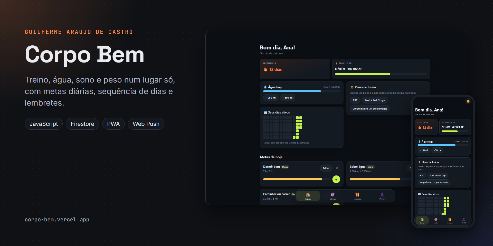
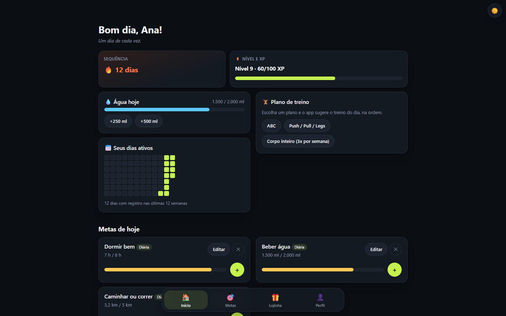
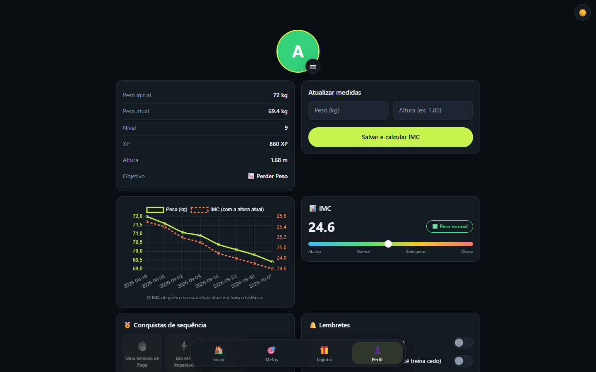
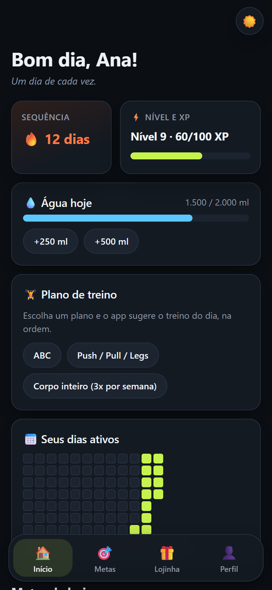

# Corpo Bem



App de treino e hábitos pensado pro celular. Você registra água, sono, treino e peso, acompanha a sequência de dias e troca o XP das metas cumpridas por recompensas que você mesmo cria. Dá pra instalar como PWA e abrir sem internet depois da primeira visita.

Site: https://corpo-bem.vercel.app

[](https://github.com/GuilhermeAraujoDeCastro/corpo-bem/actions/workflows/ci.yml)

Capturas da versão anterior às alterações locais desta revisão:

| Painel | Detalhe | No celular |
|---|---|---|
|  |  |  |

## O que tem

- Cadastro com usuário e senha ou conta Google, e um onboarding que já sugere metas conforme o objetivo (perder peso, ganhar massa ou manter).
- Metas diárias com verificação ao retomar a página, a cada 30 segundos e antes de registrar progresso, além de metas com prazo.
- Atalho de água na tela inicial (+250 ml e +500 ml).
- Planos de treino prontos (ABC, Push/Pull/Legs e corpo inteiro). O app mostra o treino da vez e passa pro próximo quando você marca que treinou.
- Calendário das últimas 12 semanas no estilo das contribuições do GitHub.
- Gráfico de peso e IMC, com exportação do histórico em CSV (abre direto no Excel).
- Exportação JSON do perfil e das coleções, incluindo treinos, sessões e recibos; sem restauração desse arquivo pela interface.
- Recompensas pessoais com custo em XP, resgate em transação e recibo único.
- Resumo da semana que vira imagem, com botão de compartilhar pelo celular.
- Link de perfil só leitura pra mostrar o progresso a um personal ou amigo. Peso e foto não entram nesse link.
- Lembretes por push de água e de metas. Pra quem costuma treinar de manhã e ainda não registrou nada, o lembrete da meta chega ao meio-dia em vez das 20h.
- Tema claro, escuro, igual ao sistema ou automático (escuro das 19h às 6h).

## Tecnologias

JavaScript puro em módulos ES, sem framework. Firebase Authentication e Firestore guardam as contas e os dados. Chart.js desenha o gráfico, canvas-confetti faz a comemoração e html2canvas gera a imagem do resumo.

No deploy, o esbuild junta os módulos num arquivo só e o javascript-obfuscator embaralha esse arquivo. CSS e HTML saem minificados. A ofuscação só deixa o código mais difícil de ler e não guarda segredo: quem protege os dados são as regras do Firestore, e a conta de serviço do Firebase e a chave privada VAPID ficam na function da Vercel.

Os lembretes rodam numa function da Vercel (`api/send-reminders.js`) com web-push e firebase-admin.

## Estrutura

```
corpo-bem/
├── index.html
├── manifest.json
├── sw.js                  service worker (cache offline e push)
├── build.js               build de produção (gera dist/)
├── vercel.json
├── firestore.rules        regras de segurança do banco
├── api/
│   └── send-reminders.js  function de lembretes
├── css/style.css
├── js/
│   ├── main.js            ponto de entrada
│   ├── firebase-config.js
│   ├── state.js
│   ├── ui.js              telas, modais, avisos e tema
│   ├── auth.js            login, cadastro e onboarding
│   ├── goals.js           metas e progresso
│   ├── plano.js           planos de treino
│   ├── profile.js         perfil, peso, calendário, exportações e perfil público
│   ├── rewards.js         lojinha
│   ├── notifications.js   lembretes e instalação do app
│   ├── recap.js           resumo da semana
│   └── calculos.js        contas sem DOM nem Firebase
├── scripts/servidor-dev.js servidor local
└── docs/capa.png          imagem deste README
```

## Rodando na sua máquina

```bash
npm ci
npm run emulators
# Em outro terminal:
npm run dev
```

O site abre em [localhost:5311](http://localhost:5311) usando exclusivamente os emuladores locais. Não há fallback para o Firebase remoto se eles estiverem desligados.

Pra conferir o build de produção, igual ao publicado:

```bash
npm run build
npm run preview
```

O GitHub Actions (`.github/workflows/ci.yml`) executa os testes de Node, o build e verificações de sintaxe.

## Deploy na Vercel

O `vercel.json` já define o build (`npm run build`), a pasta publicada (`dist`) e os cabeçalhos de segurança. Na Vercel, cadastre estas variáveis de ambiente:

- `VAPID_PUBLIC_KEY` e `VAPID_PRIVATE_KEY`: par de chaves do Web Push, gerado com `npx web-push generate-vapid-keys`. A chave pública também fica em `js/notifications.js`.
- `FIREBASE_SERVICE_ACCOUNT`: JSON da conta de serviço em uma linha só (Firebase Console, Configurações do projeto, Contas de serviço, Gerar nova chave privada).
- `CRON_SECRET`: uma senha longa qualquer. A function recusa chamadas sem ela.

O cron gratuito da Vercel só roda uma vez por dia (23h UTC, que dá 20h em Brasília). Pra ter os lembretes de hora em hora, o workflow `.github/workflows/lembretes.yml` chama a function a cada hora. Ele precisa de dois segredos no repositório do GitHub: `SITE_URL` (endereço do site na Vercel) e `CRON_SECRET` (o mesmo valor da Vercel).

Depois do primeiro deploy, adicione o domínio da Vercel em Firebase Console, Authentication, Settings, Domínios autorizados. Sem isso o login com Google falha.

## Regras do Firestore

As regras ficam em `firestore.rules`. Cada conta só lê e grava o que está em `users/{uid}`. O resumo público (`publico/{uid}`) pode ser lido por quem tem o link, mas só o dono grava, e só com os campos do resumo.

Pra publicar:

```bash
# Publicação remota deve ser revisada e executada manualmente pelo autor.
# Esta revisão usa somente emuladores locais.
```

O projeto padrão desta cópia (`demo-auditoria-corpo`) é fictício e está em `.firebaserc`. Não publique regras durante esta revisão.

## Trocando as chaves

Vale trocar as chaves VAPID e a conta de serviço de tempos em tempos:

1. Gere um par novo com `npx web-push generate-vapid-keys`.
2. Atualize `VAPID_PUBLIC_KEY` e `VAPID_PRIVATE_KEY` na Vercel e a chave pública em `js/notifications.js`, e faça um deploy.
3. Quem já tinha lembrete ligado precisa desligar e ligar de novo no perfil, porque a inscrição antiga foi feita com a chave velha. As inscrições que o navegador recusar (erro 404 ou 410) são apagadas sozinhas pela function.
4. Pra conta de serviço, gere uma chave nova no Firebase Console, troque `FIREBASE_SERVICE_ACCOUNT` na Vercel e apague a chave antiga no Google Cloud Console (IAM, Contas de serviço).

## Testando os lembretes sem incomodar ninguém

Pra testar push sem mandar notificação pra usuário de verdade, crie um segundo projeto no Firebase só pra testes e aponte um deploy de preview da Vercel pra ele: variáveis `FIREBASE_SERVICE_ACCOUNT` e `CRON_SECRET` próprias no ambiente Preview e, no preview, o `firebaseConfig` de `js/firebase-config.js` trocado pelo do projeto de teste. A resposta da function traz quantos pushes foram enviados, quantos falharam e quantas inscrições mortas foram removidas.

## Treinos personalizados e agenda

Cada modelo admite até 8 exercícios. Esse limite permite validar todos os campos dentro do orçamento de expressões das regras do Firestore; modelos e sessões têm o mesmo limite.

“Meus treinos” permite criar e editar modelos com exercícios, séries, repetições e carga em kg. Os planos prontos continuam disponíveis. Salvar modelo não registra uma sessão: ajuste os valores usados e selecione “Registrar treino de hoje”. Cada sessão conserva seu snapshot; alterar o modelo não muda o histórico. A tabela compara o volume com o registro anterior do mesmo treino. Volume significa séries × repetições × carga, sem estimar esforço ou resultados físicos.

“Descanso e pausas” guarda dias da semana e uma pausa opcional com início e fim, inclusive a data final. Esses dias preservam a sequência sem conceder XP. Limpe as duas datas para remover a pausa. É possível registrar um treino personalizado opcional no descanso; as metas diárias reabrem no próximo dia ativo.

Modelos usam `users/{uid}/workouts`; sessões usam `workoutSessions`; resgates usam `redemptions`; concessões de XP usam `goalAwards`. A agenda fica no perfil privado. Nenhuma dessas coleções entra no resumo público.

## Ferramentas, testes e limites

Ao entrar ou trocar de conta, o painel anterior é limpo e fica oculto durante o carregamento da sessão atual. Respostas atrasadas, inclusive ao sair e voltar à mesma conta, são descartadas. Se o perfil ou o carregamento principal falhar, a aplicação volta ao login com aviso; os cards da conta anterior não são reaproveitados. As regressões executam os handlers reais com consultas lentas e com erro, perfil antigo atrasado, A → B → A e logout concluído depois de um novo login.

Use Node.js 22 (versão da CI) ou 24 e npm. Os emuladores precisam de Java 21 e Firebase CLI 14.22.0, executado localmente pelo script `emulators`. Em loopback (`localhost`, `127.0.0.1`, `[::1]`), o cliente usa exclusivamente `demo-auditoria-corpo`, com Auth 9092 e Firestore 8082. A restauração automática de lembretes fica desligada. Bibliotecas por CDN ainda precisam de rede.

```bash
npm test
npm run test:emulator
npm run build
npm run preview
```

Os testes de Node cobrem a função real de edição, renovação do dia e progresso fresco em dois aparelhos simulados, XP único, resgate, calendário, pausas e treino. `test:emulator` exige os emuladores ligados e verifica regras, isolamento, tipos, replay de resgate, treinos, sessões e agenda. Testes em memória não substituem jornadas no navegador ou a concorrência com SDK real.

As datas seguem o fuso do aparelho. Metas diárias têm `progressDay`; a transação preserva o progresso que outro aparelho já registrou no dia. Progresso e resgates exigem conexão e não são apresentados como sucesso quando falham. A PWA abre arquivos em cache, mas não confirma essas operações offline. A renovação atômica aceita até 300 metas por conta.

Use dados fictícios no onboarding e nos treinos. Contas com nome de usuário usam e-mail interno `nome@webtreino.local` e não têm recuperação automática por e-mail. `.env.example` lista as credenciais do servidor sem valores. Nenhum teste local precisa de conta de serviço ou envia notificações.

As regras revisadas são um protótipo local e não foram publicadas. Dados legados não são apagados nem estornados automaticamente. Confira [migração e limites](docs/migracao-local.md) e [modelo das regras](docs/rules-model.md).

Nesta revisão, o Edge local confirmou edição com alvo negativo recusada, resgate persistente, registro de treinos e evolução, pausa sem perder a sequência, virada do dia com relógio controlado e troca de conta durante uma consulta lenta. O ensaio de resgate concorrente usou duas instâncias do SDK no emulador. As jornadas usaram dados fictícios, incluíram controles por teclado e viewport de 390 px e não fazem parte de `npm test`.

## Licença e contato

Código sob a licença MIT (veja [LICENSE](LICENSE)). As bibliotecas de terceiros estão em [CREDITS.md](CREDITS.md). Feito por Guilherme Araujo de Castro: [portfólio](https://guilhermearaujodecastro.vercel.app) · [LinkedIn](https://www.linkedin.com/in/guilherme-araujo-de-castro) · guilhermeacastro.2006@gmail.com
